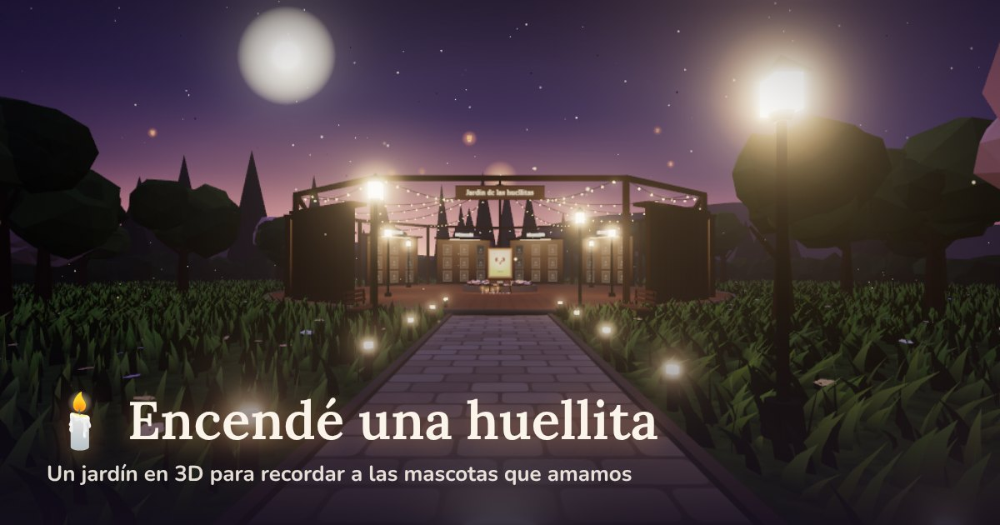

# 🕯️ Encendé una huellita

Un jardín memorial en 3D con estética de **Día de Muertos** para recordar a las mascotas que amamos.
Gratis y sin registro: poné su foto en el muro, seguí el camino de pétalos de cempasúchil hasta la
ofrenda, encendé una vela, dejá flores y firmá su libro de visitas.

> La estética se inspira en la tradición mexicana del Día de Muertos (papel picado, cempasúchil,
> ofrendas, calaveritas de azúcar, alebrijes). No usa personajes, nombres, diseños ni música de
> ninguna película.



| Compu | Celular |
| --- | --- |
|  |  |

## Qué tiene

- **Jardín 3D al atardecer** (Three.js, todo procedural): luna y estrellas que titilan, pasto que se
  mueve con el viento, árboles y cerezos, cerco de ligustros, camino con balizas, faroles, luciérnagas
  y un salón con pérgola y guirnaldas de luces. Postprocesado con *bloom* para que todo brille.
- **Luca en el centro del salón**: un atril con su retrato, rodeado de velas que se van encendiendo
  a medida que la gente le deja una.
- **Farolitos**: cada vela que se enciende (tuya o de cualquier visitante) suelta un farolito de papel
  que sube al cielo.
- **Caminar y mirar**: tocá el piso para caminar, deslizá para mirar, pellizcá o usá la rueda para
  acercarte. En compu también WASD / flechas.
- **Sumar a tu mascota**: tocá un lugar libre del muro (o el ＋), subí una foto (se recorta sola al
  marco), nombre, especie, fechas y unas palabras.
- **Velas, flores y libro de visitas** en cada huellita. Con 20 velas el marco se vuelve dorado.
- **En vivo**: cuántas personas hay ahora y qué está pasando ("Brisa Suave encendió una vela por Luca").
- **Cumpleaños**, **la hora de las velas** (21 h), **pisos** (90 lugares cada uno), **lista con
  búsqueda**, **links para compartir** (`/#h/luca`) e imagen para WhatsApp/redes.
- **Sonido** generado en el navegador: música suave, grillos y efectos.

### Día de Muertos

- Papel picado (con huellitas recortadas) entre los postes y cruzando el camino, paredes pintadas de
  colores con friso de talavera, arco de cempasúchil en la entrada y un camino de pétalos hasta la ofrenda.
- **Ofrenda** de tres escalones con Luca arriba, veladoras, calaveritas de azúcar, pan de muerto y
  un arco de flores; un marco muestra una por una las huellitas que pusieron hoy en la ofrenda.
- Pueblito de colores con las ventanas encendidas en las colinas, cielo violeta con aurora de fiesta,
  pétalos que flotan, alebrijes de colores neón y visitantes con cara de calaverita, corona de flores o sombrero.
- Música: guitarra de cuerdas punteadas en vals (composición propia generada en el navegador).
- **Ascensor** junto a la entrada del salón: indicador de piso con aguja, puertas de bronce y transición
  de puertas con "ding" al cambiar de piso. Cada piso nuevo se abre cuando se llena el de abajo.
- La huellita destacada puede tener una **estampita** (`card` en `server/seed.js`) apoyada en la
  ofrenda y pegada con cintitas en su ficha.
- Tipografías: Lobster (títulos), Caveat (escrito a mano) y Nunito.

### Para la familia (todo gratis por ahora, ver [MONETIZACION.md](MONETIZACION.md))

Luz eterna, 12 fondos, hasta 4 fotos, su voz, diario con preguntas, lugar en la ofrenda del día,
encuentros con recordatorio en el calendario, invitar a la familia con un enlace privado, editar,
tarjeta para historias, farolillo que se va volando y palabras de consuelo.

### La parte "juego" (amable)

- **Glow**: cada gesto con otras huellitas (vela, flor, regalito, abrazo, palabras) hace brillar el
  lugar de *tu* mascota: 🕯️ Llamita → 🏮 Farolito → ⭐ Estrella → ✨ Constelación. Sin rankings.
- **✨ Hoy**: gestos del día con checklist, racha de noches, "Necesitan una luz" y celebración al completar.
- **Regalitos** (🦴🎾🧶…), **abrazo en silencio** y una vela/flor por día por huellita ("volvé mañana").
- **Otros visitantes** como personajitos con su nombre, gestos (🤍🕯️🐾🌸🫂✨) y frases amables;
  **modo tranquilo** para ocultarlos.
- **Frasco de gracias**, **"mientras no estabas…"** y la **hora de las velas** con velas y países.
- Detalles: huellitas en el camino, hongos que brillan, pétalos, farolitos de papel, pizarrón de
  bienvenida, el **Puente del Arcoíris** con su arroyo, y un perrito y un gatito de luz que pasean
  (tocalos 🤍).

### Pensado para el celular

- Barra inferior al alcance del pulgar: Huellitas · Luca · ＋ · Hoy · Más, y **palanca** para caminar.
- La ficha de cada huellita es una hoja que se desliza: a media altura se ve el marco en 3D arriba;
  la arrastrás para abrirla entera o hacia abajo para cerrarla.
- Formularios a pantalla completa con el botón siempre visible, campos de 16 px (sin zoom en iPhone),
  áreas seguras del notch respetadas, vibración al encender una vela y modo horizontal.
- **Calidad automática**: detecta el dispositivo (alta / media / ahorro) y ajusta la resolución en
  vivo según los cuadros por segundo. Se puede cambiar a mano en *Más → Calidad gráfica*.
- Se puede agregar a la pantalla de inicio como app.

## Publicarlo en Vercel

1. En Vercel: **Add New → Project** e importá este repositorio. No hace falta tocar nada:
   `vercel.json` ya configura el build (Vite → `dist/`) y la API (`api/handler.js`).
2. **Conectá la base de datos** para que las velas, flores y huellitas se compartan entre todos:
   en el proyecto, **Storage → Create Database → Upstash for Redis** (tiene plan gratis) →
   conectalo al proyecto. Eso agrega solo las variables `KV_REST_API_URL` y `KV_REST_API_TOKEN`.
3. **Redeploy** (Deployments → ⋯ → Redeploy) para que tome las variables.

Sin el paso 2 el sitio funciona igual en **modo demo**: cada visitante ve sólo lo que suma en su
propio navegador (aparece un aviso abajo). Con Upstash conectado, todo es compartido y en vivo.

## Cambiar los datos de Luca

Están en [`server/seed.js`](server/seed.js): nombre, foto, cumpleaños, día que partió y mensaje.
Para la foto, poné el archivo en `public/huellitas/luca.jpg` y escribí `photo: '/huellitas/luca.jpg'`.
Las velas, flores y firmas de Luca se guardan aparte, así que cambiar sus datos no las borra.

## Correrlo en tu compu

Requiere Node 22.

```bash
npm install
npm run build
npm start            # http://localhost:8787 (guarda todo en data/kv.json)
npm run dev          # desarrollo con recarga: http://localhost:5173
npm test             # tests de la API (servidor local y función de Vercel)
```

Si definís `KV_REST_API_URL` y `KV_REST_API_TOKEN`, el servidor local también usa Upstash.

## Cómo está hecho

```
index.html              Interfaz (barra, dock, ficha, modales)
src/main.js             Arranque, intro, interacción, ficha deslizable, actividad en vivo
src/quality.js          Calidad por dispositivo y resolución adaptativa
src/api.js              Cliente de la API + modo demo (localStorage)
src/audio.js            Música, grillos y efectos con Web Audio
src/scene/world.js      Cielo, luna, colinas, pasto con viento, árboles, faroles, luciérnagas
src/scene/hall.js       Muro, marcos, pérgola, guirnaldas, atril de Luca
src/scene/lanterns.js   Farolitos que suben y destellos
src/scene/controls.js   Caminar, mirar, pellizcar, inercia, vuelos de cámara
src/scene/textures.js   Texturas dibujadas en canvas
server/core.js          La API (independiente del servidor)
server/store.js         Datos sobre Redis (Upstash o emulador local)
server/kv/              Cliente REST de Upstash y emulador de Redis
server/seed.js          Huellitas destacadas (Luca)
api/handler.js          Función de Vercel
server/index.js         Servidor local
```

### API

| Método y ruta | Qué hace |
| --- | --- |
| `GET /api/health` | Si hay base de datos conectada |
| `GET /api/memorials` | Todas las huellitas y totales |
| `POST /api/memorials` | Crea una (`name`, `species`, `photo` como data URL, `birthday`/`passedDay` en `MM-DD`, `message`, `slot`). Devuelve `editToken` |
| `GET /api/memorials/:id` | Una huellita con su libro de visitas |
| `DELETE /api/memorials/:id` | La quita (header `X-Edit-Token`) |
| `POST /api/memorials/:id/candle` | Enciende una vela (una cada 10 min por visitante) |
| `POST /api/memorials/:id/flower` | Deja una flor |
| `POST /api/memorials/:id/guestbook` | Firma el libro (`text`, `name`) |
| `GET /api/photos/:id` | La foto (cacheada en el CDN) |
| `GET /api/activity/:since` | Eventos nuevos + cuántos hay ahora |
| `POST /api/memorials/:id/gift` | Deja un regalito (`gift` del catálogo) |
| `POST /api/memorials/:id/hug` | Abrazo en silencio |
| `POST /api/now` | Latido: posición, gesto o frase; devuelve a los demás visitantes |
| `GET /api/night` | Velas y países de esta noche |
| `POST /api/memorials/:id/eternal` | Luz eterna |
| `POST /api/memorials/:id/altar` · `GET /api/altar` | Poner en la ofrenda de hoy / lista del día |
| `POST /api/memorials/:id/{edit,photos,voice,diary,gathering}` | Herramientas de la familia (header `X-Edit-Token`) |
| `POST /api/memorials/:id/diary/:pid/heart` | Corazón en una página del diario |
| `GET /api/photos/:id/:n` · `GET /api/voices/:id` | Fotos extra y voz |
| `GET/POST /api/comfort` | Palabras de consuelo |
| `GET/POST /api/jar` | Frasco de gracias |

Los gestos aceptan `glowTo` + `glowToken` (el token de edición de tu mascota) para sumarle Glow.

La investigación inicial, hecha con [REA](https://github.com/morluto/rea), está en
[`docs/investigacion-rea.md`](docs/investigacion-rea.md).

## Pendientes posibles

- Moderación de fotos y textos antes de publicarlos.
- Recuperar la edición por email (enlace mágico) en lugar del token guardado en el navegador.
- Ver a otros visitantes como siluetas en el jardín.
