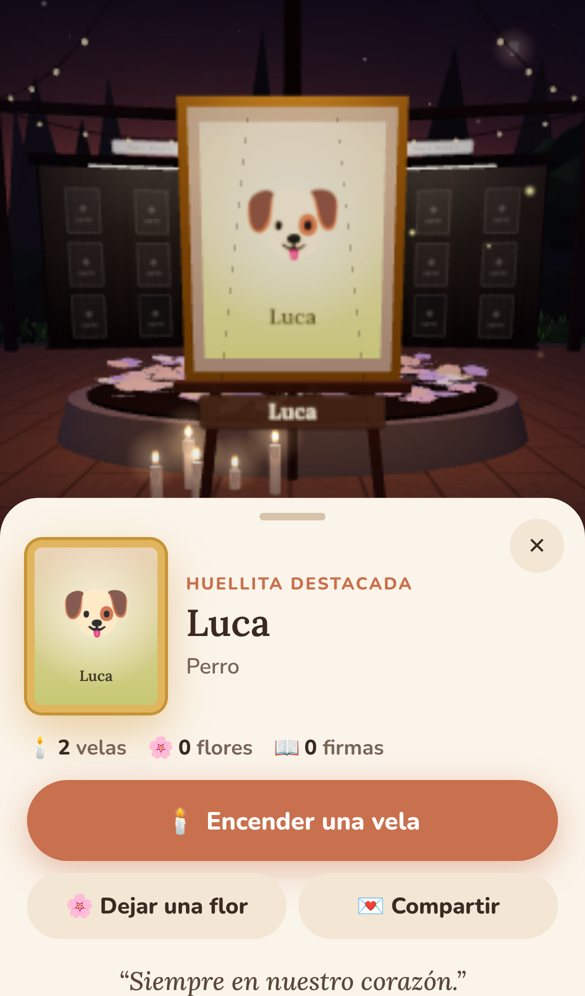

# 🕯️ Encendé una huellita

Un jardín memorial en 3D con estética de **Día de Muertos** para recordar a las mascotas que amamos.
Gratis y sin registro: poné su foto en el muro, seguí el camino de pétalos de cempasúchil hasta la
ofrenda, encendé una vela, dejá flores y firmá su libro de visitas.

> La estética se inspira en la tradición mexicana del Día de Muertos (papel picado, cempasúchil,
> ofrendas, calaveritas de azúcar, alebrijes). No usa personajes, nombres, diseños ni música de
> ninguna película.


| Compu | Celular |
| --- | --- |
|  |  |

## Qué tiene

- **Jardín 3D al atardecer** (Three.js, todo procedural): luna y estrellas que titilan, pasto que se
  mueve con el viento, árboles y cerezos, cerco de ligustros, camino con balizas, faroles, luciérnagas
  y un salón con pérgola y guirnaldas de luces. Postprocesado con *bloom* para que todo brille.
- **Luca en el centro del salón**: un atril con su retrato, rodeado de velas que se van encendiendo
  a medida que la gente le deja una.
- **Farolitos**: cada vela que se enciende (tuya o de cualquier visitante) suelta un farolito de papel
  que sube al cielo.
- **Tercera persona**: tenés tu propio personaje (cara de calaverita pintada, sarape de colores,
  sombrero o corona de cempasúchil y un farolito en la mano). Apoyá el pulgar a la izquierda y
  arrastrá (o tocá el piso) para caminar; deslizá para girar la cámara y pellizcá (o la rueda) para acercarla. En compu, WASD /
  flechas (Shift corre) y Q/E giran la cámara. La cámara esquiva muros y postes, y al visitar una
  huellita enfoca su marco mientras tu personaje se para al lado. En el menú, tocá tu nombre para elegir el color
  de tu sarape y si llevás sombrero o corona de flores.
- **Prado de los espíritus**: un claro a la derecha del camino donde juegan los espíritus de las
  huellitas del muro (Luca incluido): zoomies, se persiguen, se invitan a jugar con una reverencia,
  luchan parados en dos patas, se sacan la pelota, ruedan panza arriba, descansan y vienen a saludarte.
  Cada uno se parece a su mascota (pelaje, orejas y tamaño que eligió la familia).
- **Sacar a pasear**: desde la ficha de tu mascota (o la de Luca) su espíritu sale del marco como una
  lucecita y te acompaña: trota a tu lado, se adelanta a olfatear, se sienta cuando parás, se echa si
  te quedás mucho y se va a jugar al Prado. Tirale la pelota (te la trae), llamalo o acaricialo.
  Los demás visitantes ven el espíritu que paseás.
- **Sumar a tu mascota**: tocá un lugar libre del muro (o el ＋), subí una foto (se recorta sola al
  marco), nombre, especie, fechas, unas palabras y cómo era (pelaje, orejas, tamaño) para su espíritu.
- **Velas, flores y libro de visitas** en cada huellita. Con 20 velas el marco se vuelve dorado.
- **En vivo**: cuántas personas hay ahora y qué está pasando ("Brisa Suave encendió una vela por Luca").
- **Cumpleaños**, **la hora de las velas** (21 h), **pisos** (90 lugares cada uno), **lista con
  búsqueda**, **links para compartir** (`/h/luca`) e imagen para WhatsApp/redes.
- **Sonido** generado en el navegador: música suave, grillos y efectos.

### Para compartir (lo que hace que llegue a más gente)

- **Cada huellita tiene su link**: `/h/luca`. En WhatsApp, Instagram, Facebook y X la vista previa
  muestra su foto en un marco dorado, su nombre y "Encendé una vela" (la tarjeta la arma la app al
  sumarla o editarla; si no hay, usa su foto).
- **Invitaciones**: el link que compartís lleva tu nombre (`?de=`) y tu código (`?l=`). Quien lo abre
  ve una entrada con la foto de esa mascota y "Axel te invita a encenderle una vela", y entra directo
  a su ofrenda con el botón de la vela latiendo.
- **Pasá la luz**: después de encender tu vela, ese mismo botón te invita a pasarle la luz a alguien.
  Cuando alguien enciende una vela gracias a tu link, te avisa ("Tu luz llegó a 3 personas").
- **Modo foto** (📸 en el paseo, en los gestos o en el menú): tu espíritu viene corriendo, se sienta a
  tu lado, tu personaje saluda y sale una polaroid 4:5 con "Paseando con Luca 🐾" lista para historias.

### Día de Muertos

- Papel picado (con huellitas recortadas) entre los postes y cruzando el camino, paredes pintadas de
  colores con friso de talavera, arco de cempasúchil en la entrada y un camino de pétalos hasta la ofrenda.
- **Ofrenda** de tres escalones con Luca arriba, veladoras, calaveritas de azúcar, pan de muerto y
  un arco de flores; un marco muestra una por una las huellitas que pusieron hoy en la ofrenda.
- Pueblito de colores con las ventanas encendidas en las colinas, cielo violeta con aurora de fiesta,
  pétalos que flotan, alebrijes de colores neón y visitantes con cara de calaverita, corona de flores o sombrero.
- Música: guitarra de cuerdas punteadas en vals (composición propia generada en el navegador).
- **Ascensor al cielo** junto al camino: una torre de vidrio y bronce con cúpula de talavera. Como uno de
  verdad: tu personaje camina hasta la puerta, suena la campanita, se abren las puertas y entra a la
  cabina (madera, pasamanos de bronce, espejo, lámpara); se da vuelta y aparece la botonera con los
  **99 pisos**, todos abiertos. Se cierran las puertas y la cabina sube por la torre de vidrio con vos
  adentro (o baja hacia el piso nuevo), se cruzan unas nubes, frena, campanita y salís caminando. Cuanto más alto, más luz: el
  jardín desaparece, el salón flota sobre un mar de nubes, el cielo pasa del atardecer violeta al
  amanecer rosado y, arriba de todo, al celeste con sol, nubes de algodón y rayos de luz. En los pisos de
  arriba se camina sobre las nubes y sólo se ve a quienes están en tu mismo piso.
- **Paseo con correa**: el espíritu va adelante tuyo con collar de cuero y medallita, la correa va de tu
  mano al collar (floja o tirante según la distancia), mueve la cola y se desvía a olfatear.
- **Estilo acuarela** (opcional, se prende en Opciones): todo parece pintado a mano (papel, pigmento en
  los bordes, lavados de color).
- **Cielo mágico**: de noche, Vía Láctea, nebulosas, cometas con su cola y estrellas fugaces; arriba,
  cirros, halo del sol, nubes gigantes, islas que flotan con cascadas de luz y pájaros de luz.
- **Pasillos y pisos con nombre** ("Pasillo de las veladoras · 4 huellitas", "Piso 24 · Corredor de las
  nubes rosas"), botonera de bronce y una cabina con ojo de buey al viajar.
- **Ventanitas en el muro**: cada huellita vive en una ventanita con postigos pintados que se abren; en
  su ficha, la repisa con cada regalito y cuántos le dejaron.
- **Farolitos de papel calado** en guirnaldas sobre el camino y colgando de la pérgola del salón,
  canteros, un estanque y pétalos que se levantan al caminar.
- **Intro de película**: la cámara baja desde la Vía Láctea, pasa sobre el salón y cruza el río hasta
  quedar detrás tuyo, con dos leyendas. La música cambia con el lugar (vals en el jardín, campanitas en
  el salón, mayor y luminosa en el cielo) y los pasos suenan distinto en piedra, pasto, madera o nube.
- **Recuerdo**: una estampita con la foto bajo un arco dorado, el nombre, las fechas y las palabras de
  la familia, para guardar, imprimir o compartir.
- **36 regalitos en 3D** (bife, pelota de fútbol, barrilete, coronita, torta…), razas con orejas y hocico
  a elegir, peinados para tu personaje, auroras en los pisos del medio y un ahuehuete con farolitos.
- **Brillitos en el aire**: polvo de luz diminuto que cae muy despacio alrededor tuyo, en todos los pisos.
- **Caminito al ascensor**, con dos farolitos de papel que lo marcan.
- **Tamaños de mascota bien distintos**: Mini, Chico, Mediano, Grande y Gigante (de un chihuahua a un
  gran danés; los gatos en una escala más chica).
- **La llegada**: entrás del otro lado del río, por un camino de tierra. Cruzás el **Puente del
  Arcoíris** (el arcoíris lo envuelve) y entrás por un arco de cempasúchil con papel picado y veladoras
  ("Bienvenidos al jardín"; al salir dice "Volvé cuando quieras"). Afuera todo es más apagado; adentro,
  el jardín de colores.
- **El río**: agua de noche que refleja el cielo, la luna y los faroles del puente, con olitas que
  corren; orillas de barro húmedo, piedras con musgo, juncos, nenúfares con flor, bruma, pétalos de
  cempasúchil y velitas que flotan río abajo. Su murmullo (y algún burbujeo) sube cuando te acercás.
- **La ofrenda en 3D**: los 36 regalitos son objetos de verdad (huesito, quesito, osito, globo,
  mariposa que aletea, lunita que brilla…) y se apoyan en la repisa de cada marco o en el escalón de la
  ofrenda. Al dejar algo, tu personaje lo ofrece con los brazos: la llamita viaja hasta la veladora de
  vidrio de color, la flor estalla en pétalos sobre un jarrito de barro, el regalito vuela desde tu mano
  y el abrazo suelta corazones de luz. Los gestos de otros visitantes también se ven en el marco.
- La huellita destacada puede tener una **estampita** (`card` en `server/seed.js`) apoyada en la
  ofrenda y pegada con cintitas en su ficha.
- Tipografías: Cormorant Garamond y Young Serif (títulos), Caveat (escrito a mano), DM Sans y Nunito.

### La sexta etapa del duelo

Guía interactiva en 7 tarjetas (menú, panel **Hoy** o la bienvenida) sobre *crear significado*
después de una pérdida, con la ofrenda como práctica: responder por escrito "¿dónde está?" y
"¿cuándo lo vuelvo a ver?" (se guarda en su diario), ponerle "su cosa", decirle lo que faltó
(farolillo), no hacerlo solo (invitar a la familia) y decidir cómo sigue el vínculo (agendar el 1 y
2 de noviembre). Basada en Kessler (2019), O'Connor (2022) y Klass, Silverman y Nickman (1996);
inspirada en un carrusel de Oscar Rivas, PhD. Entre el 20 de octubre y el 2 de noviembre aparece un
aviso de temporada: *"Este año, poné su foto en la ofrenda."*

Las ventanas usan un tema vino editorial (Cormorant Garamond + DM Sans, palabra clave en itálica
naranja, etiquetas en mayúsculas) y papel picado pastel con caritas de calavera.

### Para la familia (todo gratis por ahora, ver [MONETIZACION.md](MONETIZACION.md))

Luz eterna, 12 fondos, hasta 4 fotos, su voz, diario con preguntas, lugar en la ofrenda del día,
encuentros con recordatorio en el calendario, invitar a la familia con un enlace privado, editar,
tarjeta para historias, farolillo que se va volando y palabras de consuelo.

### La parte "juego" (amable)

- **Glow**: cada gesto con otras huellitas (vela, flor, regalito, abrazo, palabras) hace brillar el
  lugar de *tu* mascota: 🕯️ Llamita → 🏮 Farolito → ⭐ Estrella → ✨ Constelación. Sin rankings.
- **✨ Hoy**: gestos del día con checklist, racha de noches, "Necesitan una luz" y celebración al completar.
- **Regalitos** (🦴🎾🧶…), **abrazo en silencio** y una vela/flor por día por huellita ("volvé mañana").
- **Otros visitantes** como personajitos con su nombre, gestos (🤍🕯️🐾🌸🫂✨) y frases amables;
  **modo tranquilo** para ocultarlos.
- **Frasco de gracias**, **"mientras no estabas…"** y la **hora de las velas** con velas y países.
- Detalles: huellitas en el camino, hongos que brillan, pétalos, farolitos de papel, pizarrón de
  bienvenida, huellitas que llevan hasta el **Puente del Arcoíris**, y un perrito y un gatito de luz
  que pasean (tocalos 🤍).

### Pensado para el celular

- **Interfaz de juego, casi sin nada en pantalla**: arriba, un botón de menú con un anillo que se va
  llenando con los gestos de Hoy; abajo a la izquierda, una **palanca invisible** que aparece donde
  apoyás el pulgar; abajo a la derecha, **un solo botón** que cambia según lo que tengas cerca (🕯️ la
  ofrenda o un marco, ＋ un lugar libre, 🎾 la pelota, 🛗 el ascensor, 🫙 el frasco, 🐾 tu mascota o 🤍
  gestos). Mientras caminás, todo se desvanece y vuelve cuando frenás.
- El menú es una hoja con íconos grandes: Huellitas, Luca, Hoy, Sumar mascota, Pisos, Prado, Foto,
  Opciones y lo "para el corazón" (la sexta etapa, frasco, farolillo, consuelo).
- La ficha de cada huellita es una hoja que se desliza: a media altura se ve el marco en 3D arriba;
  la arrastrás para abrirla entera o hacia abajo para cerrarla.
- Formularios a pantalla completa con el botón siempre visible, campos de 16 px (sin zoom en iPhone),
  áreas seguras del notch respetadas, vibración al encender una vela y modo horizontal.
- **Calidad automática**: detecta el dispositivo (alta / media / ahorro) y ajusta la resolución en
  vivo según los cuadros por segundo. Se puede cambiar a mano en *Más → Calidad gráfica*.
- Se puede agregar a la pantalla de inicio como app.

## Publicarlo en Vercel

La producción de este repositorio ya está conectada a Upstash y publica desde `main` con Node 22.
La base está vinculada sólo a Production; las previews conservan el modo demo. Estas instrucciones
sirven para un proyecto nuevo:

1. En Vercel: **Add New → Project** e importá este repositorio. No hace falta tocar nada:
   `vercel.json` ya configura el build (Vite → `dist/`) y la API (`api/handler.js`).
2. **Conectá la base de datos** para que las velas, flores y huellitas se compartan entre todos:
   en el proyecto, **Storage → Create Database → Upstash for Redis** (tiene plan gratis) →
   conectalo al proyecto. Eso agrega solo las variables `KV_REST_API_URL` y `KV_REST_API_TOKEN`.
3. **Redeploy** (Deployments → ⋯ → Redeploy) para que tome las variables.

Sin el paso 2 el sitio funciona igual en **modo demo**: cada visitante ve sólo lo que suma en su
propio navegador (aparece un aviso abajo). Con Upstash conectado, todo es compartido y en vivo.

**Antes de conectar una base a un sitio que ya se usó en modo demo:** los recuerdos de esos
navegadores no se importan automáticamente. No borres sus datos; el rescate está pendiente en
`PENDIENTES.md`. El permiso de edición también se guarda en el navegador: conservá el enlace de
familia para poder entrar desde otro dispositivo.

La base conserva el historial de diarios, mensajes, regalitos, notas y gestos sin borrar los
anteriores cuando llegan nuevos. La interfaz muestra los más recientes; consultar los anteriores
con paginación sigue pendiente. La presencia se actualiza cada 5–12 segundos.

## Cambiar los datos de Luca

Están en [`server/seed.js`](server/seed.js): nombre, foto, cumpleaños, día que partió y mensaje.
Para la foto, poné el archivo en `public/huellitas/luca.jpg` y escribí `photo: '/huellitas/luca.jpg'`.
Las velas, flores y firmas de Luca se guardan aparte, así que cambiar sus datos no las borra.

## Correrlo en tu compu

Requiere Node 22.

```bash
npm install
npm run build
npm start            # http://localhost:8787 (guarda todo en data/kv.json)
npm run dev          # desarrollo con recarga: http://localhost:5173
npm test             # tests de la API (servidor local y función de Vercel)
```

Con `npm run dev` también está el **laboratorio de espíritus**: `/lab/pets.html` muestra todas las
poses (`?pose=sit`, `?side` de costado) y `/lab/pets.html?mode=pack` simula el Prado.

Si definís `KV_REST_API_URL` y `KV_REST_API_TOKEN`, el servidor local también usa Upstash.

## Cómo está hecho

```
index.html              Interfaz (barra, dock, ficha, modales)
src/styles.css          Estilos (tema vino en paneles, papeles claros)
src/main.js             Arranque, intro, interacción, ficha deslizable, actividad en vivo
src/quality.js          Calidad por dispositivo y resolución adaptativa
src/api.js              Cliente de la API + modo demo (localStorage)
src/share.js            Links /h/<id>, invitaciones, "Pasá la luz" y la tarjeta para la vista previa
src/photo.js            La polaroid del modo foto
src/game.js             Gestos del día, racha y Glow guardado
src/guide.js            La sexta etapa del duelo (guía en 7 tarjetas)
src/floors.js           Nombres de los 99 pisos y de los pasillos
src/audio.js            Música, grillos y efectos con Web Audio
src/scene/world.js      Plano del jardín, cielo, luna, colinas, pasto con viento, árboles, faroles, luciérnagas
src/scene/hall.js       Muro con ventanitas, pérgola, guirnaldas, ofrenda y atril de Luca
src/scene/muertos.js    Papel picado, cempasúchil, calaveritas, pan de muerto, pueblito
src/scene/cozy.js       Camino de pétalos, frasco de gracias, alebrijes, Prado de los espíritus
src/scene/river.js      El río, el Puente del Arcoíris y el arco de entrada al jardín
src/scene/elevator.js   La torre del ascensor y su cabina
src/scene/heaven.js     Los pisos hacia el cielo (mar de nubes, sol, rayos)
src/scene/skymagic.js   Cometas, estrellas fugaces, nubes gigantes, islas y pájaros de luz
src/scene/watercolor.js El pase de acuarela (Opciones → Estilo acuarela)
src/scene/sparkles.js   Brillitos que caen alrededor de la cámara
src/scene/lanterns.js   Farolitos de papel (los que suben y los que cuelgan)
src/scene/controls.js   Tercera persona: personaje, palanca, cámara que sigue/enfoca, colisiones
src/scene/character.js  El personaje de cada visitante (caminar, saludar, tirar, acariciar)
src/scene/avatars.js    Los demás visitantes
src/scene/petRig.js     Cuerpo procedural de los espíritus y su animador (marchas y acciones)
src/scene/spirits.js    Cerebro de los espíritus: el Prado, el paseo, la pelota, huellitas de luz
src/scene/gifts3d.js    Regalitos en 3D y efectos de los gestos (vela, flor, regalito, abrazo)
src/scene/textures.js   Texturas dibujadas en canvas
server/core.js          La API (independiente del servidor)
server/store.js         Datos sobre Redis (Upstash o emulador local)
server/kv/              Cliente REST de Upstash y emulador de Redis
server/seed.js          Huellitas destacadas (Luca)
server/glow.js          Reglas del Glow, regalitos, frases y gestos
server/plans.js         Funciones que serán pagas (hoy gratis) y fondos
server/looks.js         Pelajes, orejas y tamaños (formulario, 3D y validación)
server/page.js          Vista previa de cada huellita en /h/<id> (local y Vercel)
server/index.js         Servidor local
api/handler.js          Función de Vercel
scripts/dev.mjs         Levanta Vite y la API juntos (npm run dev)
scripts/recorrido.mjs   Recorrido de punta a punta con Playwright (6 dispositivos)
lab/pets.html           Laboratorio de poses y simulación del Prado (sólo en desarrollo)
lab/gifts.html          Los 36 regalitos en 3D juntos (sólo en desarrollo)
```

### API

| Método y ruta | Qué hace |
| --- | --- |
| `GET /api/health` | Si hay base de datos conectada |
| `GET /api/memorials` | Todas las huellitas y totales |
| `POST /api/memorials` | Crea una (`name`, `species`, `photo` como data URL, `birthday`/`passedDay` en `MM-DD`, `message`, `slot`, `look` = `{fur, ears, size, pattern}`). Devuelve `editToken` |
| `GET /api/memorials/:id` | Una huellita con su libro de visitas |
| `DELETE /api/memorials/:id` | La quita (header `X-Edit-Token`) |
| `POST /api/memorials/:id/candle` | Enciende una vela (una por día por huellita y visitante) |
| `POST /api/memorials/:id/flower` | Deja una flor (una por día, igual que el regalito y el abrazo) |
| `POST /api/memorials/:id/guestbook` | Firma el libro (`text`, `name`) |
| `GET /api/photos/:id` | La foto (cacheada en el CDN) |
| `POST /api/memorials/:id/gift` | Deja un regalito (`gift` del catálogo) |
| `POST /api/memorials/:id/hug` | Abrazo en silencio |
| `GET /h/:id` | La app con la vista previa de esa huellita (`?de=` quién invita) |
| `POST /api/memorials/:id/og` · `GET /api/og/:id` | Tarjeta 1200x630 para la vista previa (la sube la familia, sólo JPG) |
| `GET /api/ref/:code` | Cuántas velas se encendieron por los links de ese código (las velas aceptan `ref`) |
| `POST /api/now` | Latido: posición y rumbo del personaje, gesto o frase, y `pet` (el espíritu que pasea); devuelve a los demás visitantes y, con `since`, los eventos nuevos (`events`, `seq`) |
| `GET /api/night` | Velas y países de esta noche |
| `POST /api/memorials/:id/eternal` | Luz eterna |
| `POST /api/memorials/:id/altar` · `GET /api/altar` | Poner en la ofrenda de hoy / lista del día |
| `POST /api/memorials/:id/{edit,photos,voice,diary,gathering}` | Herramientas de la familia (header `X-Edit-Token`) |
| `POST /api/memorials/:id/diary/:pid/heart` | Corazón en una página del diario |
| `GET /api/photos/:id/:n` · `GET /api/voices/:id` | Fotos extra y voz |
| `GET/POST /api/comfort` | Palabras de consuelo |
| `GET/POST /api/jar` | Frasco de gracias |

Los gestos aceptan `glowTo` + `glowToken` (el token de edición de tu mascota) para sumarle Glow.

¿Vas a seguir el proyecto? Empezá por [`AGENTS.md`](AGENTS.md) y [`PENDIENTES.md`](PENDIENTES.md).

La investigación inicial, hecha con [REA](https://github.com/morluto/rea), está en
[`docs/investigacion-rea.md`](docs/investigacion-rea.md).

## Pendientes

Lo que falta, priorizado, está en [`PENDIENTES.md`](PENDIENTES.md). Lo más urgente: rescatar los recuerdos
del modo demo anterior, moderación mínima y probarlo en teléfonos reales. Producción ya usa Upstash.
