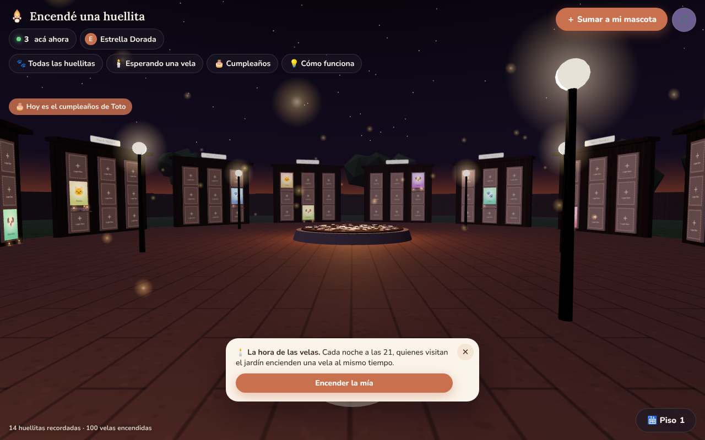

# 🕯️ Encendé una huellita

Un jardín memorial en 3D para recordar a las mascotas que amamos. Gratis y sin registro:
poné su foto en el muro, encendé una vela, dejá flores y firmá su libro de visitas.



- **Jardín 3D al atardecer** (Three.js): camino de piedra, faroles, árboles, luciérnagas y un muro
  en semicírculo con 90 lugares por piso.
- **Caminar y mirar**: tocá el piso para caminar, arrastrá para mirar. En compu, WASD / flechas.
- **Sumar a tu mascota**: tocá un lugar libre (o "＋ Sumar a mi mascota"), subí una foto, nombre,
  especie, cumpleaños y unas palabras. Si no hay foto, se dibuja un retrato ilustrado.
- **Velas, flores y libro de visitas** en cada huellita. Las velas se ven encendidas en la repisa
  del marco; con 20 velas el marco se vuelve dorado.
- **En vivo**: "N acá ahora" y un feed de actividad ("Brisa Suave encendió una vela por Luna").
- **Cumpleaños**, **la hora de las velas** (21 h), **pisos**, **lista con búsqueda** y
  **links para compartir** (`/#h/<id>`).
- **Música ambiente** generada en el navegador con Web Audio.
- **Modo local**: si no hay servidor (por ejemplo, en un hosting estático), funciona igual
  guardando todo en el navegador.

La investigación previa, hecha con [REA](https://github.com/morluto/rea) sobre un sitio de
referencia del mismo género, está en [`docs/investigacion-rea.md`](docs/investigacion-rea.md).

## Cómo correrlo

Requiere Node 20.19 o más nuevo.

```bash
npm install
npm run build
npm start            # http://localhost:8787
```

Para desarrollo (API con recarga + Vite con HMR en http://localhost:5173):

```bash
npm run dev
```

Tests de la API:

```bash
npm test
```

### Variables de entorno

| Variable | Por defecto | Para qué |
| --- | --- | --- |
| `PORT` | `8787` | Puerto del servidor |
| `DATA_DIR` | `./data` | Dónde se guardan `db.json` y las fotos subidas |

## Estructura

```
index.html            Interfaz (barra, modales, ficha, lista)
src/main.js           Arranque, interacción y UI
src/api.js            Cliente de la API + modo local (localStorage)
src/audio.js          Música ambiente con Web Audio
src/scene/world.js    Cielo, pasto, camino, faroles, árboles, luciérnagas
src/scene/hall.js     Muro de huellitas: marcos, velas, flores, pisos
src/scene/controls.js Caminar, mirar, colisiones, vuelo a un marco
src/scene/textures.js Texturas dibujadas en canvas
server/index.js       Servidor HTTP sin dependencias: API + estáticos + fotos
server/store.js       Persistencia en JSON con escritura atómica
server/seed.js        Huellitas de ejemplo (marcadas como "Ejemplo")
```

## API

| Método y ruta | Qué hace |
| --- | --- |
| `GET /api/memorials` | Lista todas las huellitas y totales |
| `POST /api/memorials` | Crea una (`name`, `species`, `photo` como data URL, `birthday`/`passedDay` en `MM-DD`, `message`, `slot`). Devuelve `editToken` |
| `GET /api/memorials/:id` | Una huellita con su libro de visitas |
| `DELETE /api/memorials/:id` | La quita (header `X-Edit-Token`) |
| `POST /api/memorials/:id/candle` | Enciende una vela (una cada 10 min por visitante) |
| `POST /api/memorials/:id/flower` | Deja una flor |
| `POST /api/memorials/:id/guestbook` | Firma el libro (`text`, `name`) |
| `GET /api/activity?since=<seq>` | Eventos nuevos + cuántos hay ahora |
| `POST /api/now` | Latido de presencia (`sid`) |

## Próximos pasos posibles

- Moderación de fotos y textos antes de publicarlos.
- Recuperar la edición por email (enlace mágico) en lugar del token en el navegador.
- Ver a otros visitantes como avatares en el jardín.
- Pasar de `db.json` a SQLite/Postgres y las fotos a un bucket si crece mucho.
